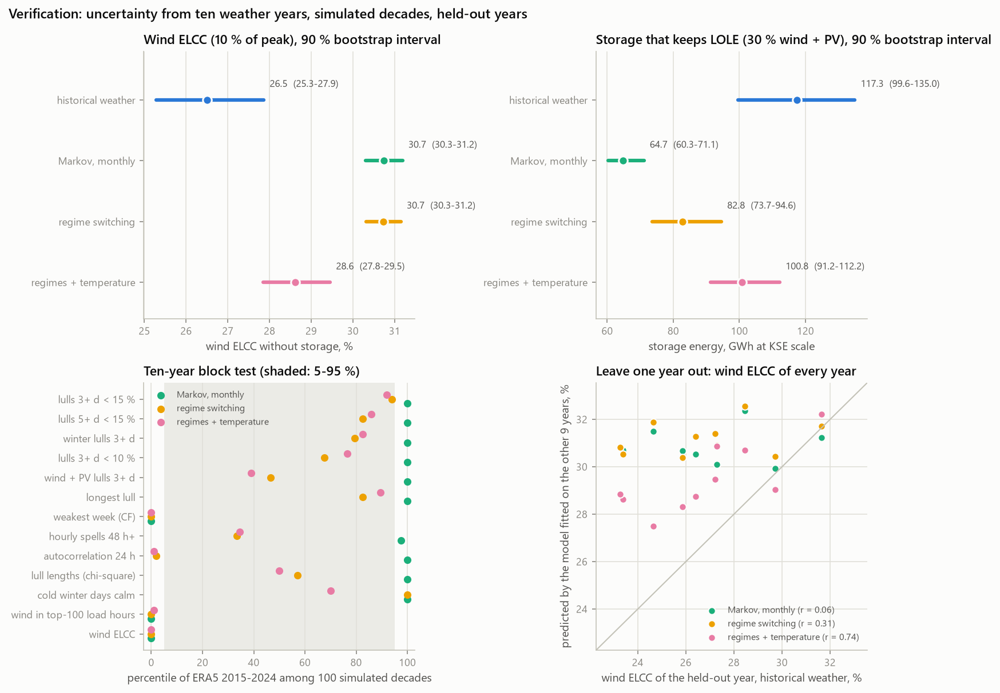
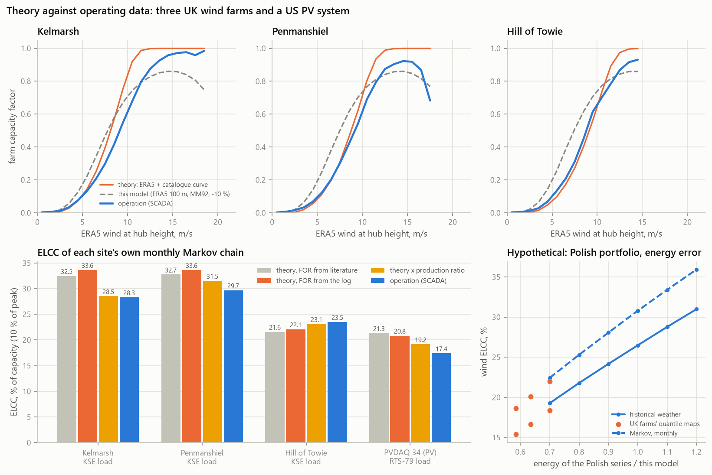
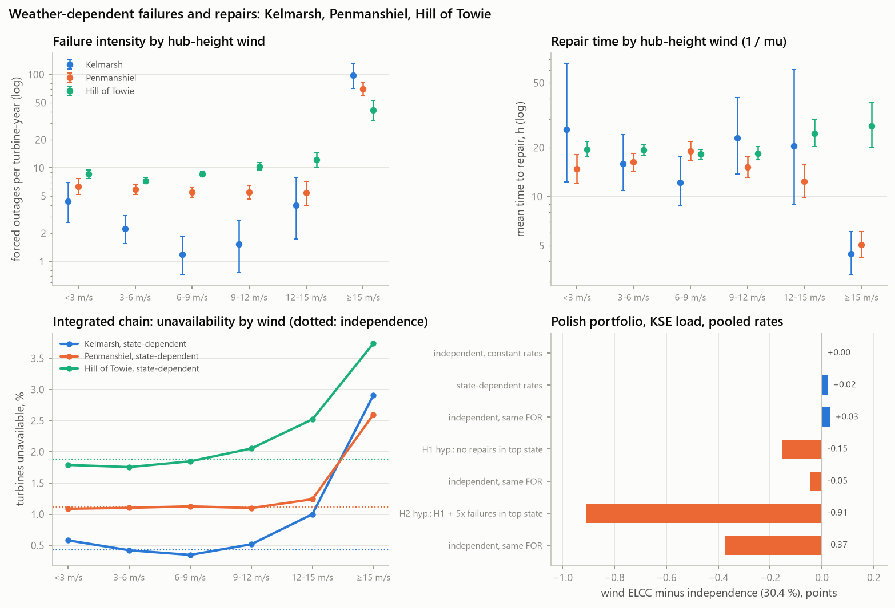

# Reliability of wind and PV in Poland: Markov models, Monte Carlo adequacy and ELCC

[](https://github.com/kwwaleszczynski-del/pl-res-reliability-markov/actions/workflows/ci.yml)

How much firm capacity is a wind or PV plant in Poland worth, and how much does the answer depend on how its
output is modelled? This project builds **multi-state Markov models of primary-energy availability** for wind and
PV at 29 ERA5 grid points over Poland (2015-2024), adds **structural reliability** estimated from open event logs,
runs **sequential Monte Carlo** adequacy assessment (LOLE, EENS, LOLF) on the IEEE Reliability Test System with
its own load and with the real hourly demand of the Polish power system (PSE), and computes the **effective load
carrying capability (ELCC)** of each point and of a distributed national portfolio, compared with the derating
factors (KWD) of the Polish capacity market.

It reproduces, on open data only, the method of the author's master's thesis *"Verification of reliability models
in photovoltaic and wind power systems"* (2025), and extends and refines it. A second part adds what first-order
chains cannot do: a **regime-switching weather model** with multi-day lulls and the cold-calm link to demand, and
**storage** in the sequential Monte Carlo, with the ELCC of 1-8 h storage against the capacity-market factors and the
storage energy needed to keep LOLE unchanged as wind and PV grow ([Storage and multi-day lulls](#storage-and-multi-day-lulls)).
A third part takes the two remaining questions of the thesis to real operating data: whether models built from
reanalysis weather and a catalogue power curve are good enough or must be calibrated on SCADA
([Theory against operating data](#theory-against-operating-data)), and whether failures and repairs that depend on
the weather break the independence of the production and structural models
([Weather-dependent failures and repairs](#weather-dependent-failures-and-repairs)).

**Interactive dashboard:** <https://kwwaleszczynski-del.github.io/pl-res-reliability-markov/>

## Key results

National portfolio = equal capacity at the 29 grid points; weather and demand 2015-2024; generating system =
IEEE RTS-79 (3405 MW). Unless stated otherwise RES is 10 % of the peak load per technology, and Monte Carlo uses
5000 simulated years per variant (± = 95 % confidence interval of the mean).

**Test system check.** The analytical engine reproduces the published RTS-79 indices exactly (LOLE 9.394 h/yr,
LOEE 1176 MWh/yr); sequential Monte Carlo gives 9.22 ± 0.45 h/yr and 1153 ± 81 MWh/yr with 1.87 loss-of-load
events per year. With the real KSE load shape the same fleet meets the 3 h/yr standard at a peak of 2505 MW;
scaled to 2850 MW, as in the thesis, it would have LOLE 35 h/yr.

| Variant (wind 10 % + PV 10 % of peak) | KSE load: LOLE h/yr | EENS MWh/yr | events/yr | ELCC % | RTS-79 load: LOLE h/yr | ELCC % |
|---|---|---|---|---|---|---|
| conventional only | 3.06 ± 0.24 | 301 | 0.63 | | 9.22 ± 0.45 | |
| Markov monthly, FOR from literature (wind 5 %, PV 3 %) | 1.14 ± 0.13 | 102 | 0.28 | 20.7 | 3.91 ± 0.27 | 20.0 |
| Markov monthly, FOR from open data | 1.11 ± 0.13 | 99 | 0.27 | 21.2 | 3.82 ± 0.26 | 20.5 |
| Markov monthly, no structural outages | 1.09 ± 0.12 | 98 | 0.27 | 21.6 | 3.76 ± 0.26 | 20.8 |
| Markov homogeneous (one matrix), FOR from data | 1.24 ± 0.13 | 112 | 0.31 | 19.1 | 4.26 ± 0.28 | 18.3 |
| **historical weather years, FOR from data** | **1.27 ± 0.14** | **115** | **0.29** | **18.6** | **3.94 ± 0.27** | **19.8** |
| thesis implementation¹ | 1.32 ± 0.14 | 121 | 0.33 | 18.0 | 4.48 ± 0.29 | 17.1 |
| wind only (Markov monthly, FOR data) | 1.45 ± 0.15 | 131 | 0.33 | 31.3 | 4.90 ± 0.30 | 29.3 |
| PV only (Markov monthly, FOR data) | 2.43 ± 0.20 | 235 | 0.55 | 10.2 | 7.47 ± 0.40 | 10.1 |

¹ homogeneous chain, bin-centre state levels, every farm out with probability FOR (5 % / 3 %) independently in
each hour. ELCC from the Monte Carlo margins with common random numbers; the exact COPT values agree within
0.7 percentage points, and every Monte Carlo LOLE lies within its confidence interval of the exact expectation.

- **Model structure matters more than the reliability parameters.** Literature FOR (5 %) against the open-data
  value (0.42 %) moves the portfolio ELCC by 0.5 points and LOLE by 3 %. Replacing the monthly chain by a single
  homogeneous matrix costs 2.1 points: one matrix spreads the winter wind maximum over the whole year, which for
  wind alone means 25.4 % instead of 30.8 %.
- **Real weather-demand correlation costs wind ELCC.** With the KSE load and weather of the same year the wind
  portfolio's ELCC is 26.5 %; pairing the same loads with the *other* nine weather years gives 29.1 % (28.6-30.0 %
  for every shift). Cold, calm winter spells coincide with high demand. A Markov chain is independent of the load
  and cannot see this, so the monthly chain overstates wind ELCC (30.8 %) and only historical weather is a safe
  reference. PV shows no such effect (10.2 % in both pairings). On the synthetic RTS-79 load the chain and
  historical weather agree within about a point.
- **The number of states matters only through the state levels.** With the thesis's bin-centre levels (0, 25,
  50, 75, 100 %), a two-state model gives wind ELCC 7.6 % and 47 % more LOLE than 15 states, and the results settle
  only from about 7 states. With energy-preserving (conditional-mean) levels every model from 2 to 15 states is
  within ±1 point of ELCC (25.1-26.6 % homogeneous, 30.4-32.0 % monthly) and 4 % of LOLE. Event frequency
  (0.33-0.40 /yr) and duration (4.2-4.8 h) hardly move with the number of states either.
- **Where wind is worth most.** Wind ELCC per point (a plant of 10 % of peak, historical weather, KSE load)
  ranges 21.7-29.4 %, highest on the West Pomeranian coast, and follows the capacity factor (r = 0.94). PV ranges
  only 9.1-10.9 %, highest in the south and south-east.
- **Capacity market.** ELCC falls with penetration: onshore wind from 29.6 % (2 % of peak) to 19.1 % at 40 % of
  peak and 13.0 % at 100 %; PV from 12.4 % to 3.9 % at 80 % and 3.3 % at 100 % (historical weather, KSE load).
  The capacity-market factors for 2028-2030 are 12.5-13.8 % for onshore wind and 1.6-2.8 % for solar. With today's
  fleet (about 11 GW of onshore wind and over 20 GW of PV against a peak of about 28 GW) the model lands in the
  same order of magnitude, above the official factors. The official values come from the real system's stress
  hours, which this stylised fleet does not reproduce, so the comparison is indicative.
- **Structural reliability from open data.** Kelmarsh: 332 forced outages in 300 528 turbine-hours, FOR 0.44 %
  (98 stops ≥ 1 h: FOR 0.42 %, MTTR 12.9 h, MTTF 3054 h). That is about a tenth of the literature value of 5 %.
  Grid-side stops (0.74 % of the time), scheduled maintenance (0.69 %) and requested shutdowns (0.40 %) are
  separate categories. PVDAQ 34: one inverter failure of 34 days (389 daylight hours) in two years, FOR 5.7 % of
  daylight time against 3 % in the literature, from a single event. Raising wind FOR from 0 to 10 % lowers wind
  ELCC from 30.8 % to 28.0 % with independent turbines, or 26.7 % if the whole portfolio fails as one plant.
- **How much data.** A monthly chain fitted on one year gives wind ELCC between 27.4 % and 33.5 % depending on
  the year; five-year windows narrow this to 30.6-31.5 %. Single historical years range from 23.3 % (2023) to
  31.7 % (2020) for wind and 8.4-12.3 % for PV. Wind speeds ±5 % move wind ELCC by about ±2.4 points.


*ELCC of the national portfolio versus installed capacity; bands are the capacity-market factors (KWD) for onshore
wind (blue) and solar (orange) in the 2028-2030 auctions.*


### Markov models against the ERA5 series


- **Energy and seasonality.** Mean wind CF is 28.7 % in the data, 28.6 % (homogeneous) and 28.9 % (monthly) in the
  chains. Only the monthly chain reproduces the swing between 39 % in winter and 18 % in August. PV: 14.3 % in the data,
  14.4 % and 14.8 % in the chains (the monthly PV chain overstates June-July by up to 2.4 points).
- **Persistence.** Mean residence times match by construction (12 h in the lowest wind state). The autocorrelation
  decays faster than in the data: 0.31 (homogeneous) and 0.40 (monthly) against 0.52 at 24 h. Low-output spells
  of 48 h or more occur 4.5 times a year in the data but 2.8-2.9 times in the chains, and the longest calm lasts
  165 h against 92-102 h. A first-order chain is good enough for expected LOLE/EENS, but not for studies where
  energy matters, such as storage sizing (see [Storage and multi-day lulls](#storage-and-multi-day-lulls)).
- **Out of sample.** Fitted on 2015-2022 and tested on 2023-2024 at all 29 points, the chains predict the test
  transitions as well as matrices fitted on the test years themselves. The median log-likelihood per transition
  for wind is -0.474 for both, -0.470 for the monthly chain, and -1.31 without persistence (i.i.d.). The
  Anderson-Goodman test still detects that the transition probabilities differ between the periods at 16 of 29
  points for wind and 13 of 29 for PV (p < 0.05). With up to 17 500 test transitions it detects small changes:
  the median largest difference in a single probability is 0.012 for wind and 0.029 for PV.


### From the thesis implementation to this repository

| Thesis implementation | This repository |
|---|---|
| simplified RTS-79 load built from daily, weekday and monthly factors (peak above 2850 MW) | published RTS-79 load model, reference LOLE and LOEE reproduced exactly |
| conventional units drawn independently every hour from FOR | two-state units with exponential MTTF / MTTR (sequential) |
| random numbers drawn in parallel workers without a fixed seed per year | `SeedSequence(seed, spawn_key=(year,))`: every simulated year reproducible on its own |
| one homogeneous transition matrix, bin-centre levels | also month-dependent chains, energy-preserving levels, and historical weather as the reference |
| historical weather and Markov simulation discussed together | Markov chain vs historical weather years compared explicitly |
| ELCC: removing whole conventional units, linear interpolation, fresh random numbers at each step | load shift solved exactly on the COPT, checked with common-random-number Monte Carlo |
| chi-square / KS tests on state frequencies | out-of-sample likelihood and the Anderson-Goodman test on transition counts |
| two farms and a PV aggregate | 29-point grid, map of ELCC and CF, distributed portfolio, comparison with KWD |
| synthetic multi-year KSE profile built from annual reports | real hourly PSE demand 2015-2024 aligned with the weather years |
| first-order chains only | regime-switching model with multi-day memory, conditioned on temperature; storage in the Monte Carlo |
| literature against empirical parameters (OZE-LIT vs OZE-EMP) on confidential SCADA | reanalysis + catalogue curve against the open SCADA of three wind farms and a PV system, with the effect on LOLE, EENS and ELCC |
| independence checked with a Kronecker-sum generator | the Kronecker sum shown to *be* independence; failure and repair intensities by production state from open logs, block generator |

## Storage and multi-day lulls

The first-order chains above are good enough for adequacy without storage, but they forget a calm within a day or
two, and the monthly chain overstates wind ELCC because it cannot see cold, calm days. Storage turns both into an
energy question. This part adds a **regime-switching weather model** with explicit lull durations, shared by wind,
PV and all grid points and optionally conditioned on temperature ([method](docs/weather_storage_method.md)), and **storage inside the sequential
Monte Carlo** ([method](docs/weather_storage_method.md#8-storage-in-the-sequential-monte-carlo)). The same batteries in the market: [pl-bess-revenue-stack](https://github.com/kwwaleszczynski-del/pl-bess-revenue-stack)
(arbitrage and balancing reserves), [pl-bess-saturation](https://github.com/kwwaleszczynski-del/pl-bess-saturation)
(spreads as the fleet grows) and [bess-capacity-augmentation](https://github.com/kwwaleszczynski-del/bess-capacity-augmentation)
(ageing against the capacity-market obligation).

### Weather models with memory

200 synthetic years per model against the ten ERA5 years of the national portfolio. "Regimes + temperature" is
the regime model conditioned on the temperature of the weather year; the lull thresholds are absolute and the
model is not fitted to them.

| National portfolio | ERA5 | Markov, monthly | regime switching | regimes + temperature |
|---|---|---|---|---|
| wind lulls of 5+ days (daily CF < 15 %), per year | **4.2** | 1.06 | 3.60 | 3.62 |
| same, October-March only | **0.7** | 0.06 | 0.70 | 0.80 |
| wind lulls of 5+ days below 10 %, per year | **0.6** | 0.06 | 0.55 | 0.60 |
| wind + PV lulls of 3+ days below 10 % (equal capacity), per year | **2.2** | 0.55 | 2.36 | 2.45 |
| longest lull of the year (CF < 15 %), mean, days | **9.0** | 5.4 | 8.1 | 8.1 |
| lowest 7-day mean wind CF of the year, % | **7.7** | 11.3 | 8.9 | 8.9 |
| hourly spells below 12.5 % of 48 h or more, per year | **4.5** | 3.4 | 4.7 | 4.8 |
| wind autocorrelation at 24 / 72 / 168 h | **0.52 / 0.26 / 0.17** | 0.39 / 0.18 / 0.15 | 0.56 / 0.27 / 0.16 | 0.55 / 0.27 / 0.16 |
| winter days with CF < 15 %: coldest / warmest third, % | **28 / 3** | 8 / 8 | 17 / 17 | 25 / 10 |
| wind CF in the 100 highest-load hours (annual mean 28.7 %), % | **26.2** | 38.4 | 38.3 | 31.6 |
| wind ELCC without storage (10 % of peak, KSE load), % | **26.5** | 30.8 | 30.7 | 28.6 |
| wind + PV ELCC without storage (10 % + 10 %), % | **33.5** | 37.2 | 37.0 | 35.0 |


- **Memory is restored.** The monthly chain produces a quarter of the 5-day lulls and almost no lull longer than a
  week (0.06 a year in winter against 0.7). The regime model follows the ERA5 distribution of lull lengths from 1
  to 10 days, the autocorrelation over a whole week and the frequency of dark, calm spells of wind and PV
  together. It still makes the deepest week of a year a little milder than the data (8.9 % against 7.7 %).
- **Cold calm is half restored.** Conditioning on temperature makes calm winter days two and a half times more
  common in the coldest third of days than in the warmest (25 % against 10 %; ERA5 28 % against 3 %; the
  first-order chain is flat at 8 %). Wind output in the 100 highest-load hours drops from 38 % to 32 % of
  capacity (ERA5 26 %) and wind ELCC from 30.7 % to 28.6 %, halfway to the 26.5 % of historical weather. Without
  the covariate, memory alone changes nothing for ELCC without storage: only the hour-by-hour distribution and its
  alignment with the load matter there.
- **One regime for all points carries most of the spatial correlation.** Simulating the 29 grid points
  separately with a shared daily regime gives a mean correlation of daily wind anomalies between points of 0.63
  (ERA5 0.77, independent chains 0.01), and the portfolio rebuilt from the points has 4.3 lulls of 5+ days a year
  (ERA5 4.2); independent chains average out to a portfolio without a single one.

### Capacity value of storage

ELCC of a storage fleet in % of its power (KSE load scaled so that the system with its wind and PV is at LOLE
3 h/yr; round trip 85 %, half full on 1 January; 2000 simulated years with common random numbers; historical
weather, wind and PV 10 % of peak each):

| Storage fleet (power, % of peak) | 1 h | 2 h | 4 h | 8 h | marginal ELCC of the last block, 4 h |
|---|---|---|---|---|---|
| 1 % | 49.6 | 66.0 | 80.9 | 92.2 | 80.9 |
| 5 % | 35.1 | 53.5 | 73.1 | 89.6 | 71.1 |
| 10 % | 28.4 | 42.9 | 62.9 | 84.0 | 52.8 |
| 20 % | 21.7 | 33.0 | 49.1 | 64.3 | 35.2 |


- **Duration decides.** Loss-of-load events in this system last 4.6 h on average, and ELCC is set by the longest
  ones, so even the first small block is worth only half of its power at 1 h, two thirds at 2 h, 81 % at 4 h and
  92 % at 8 h.
- **The fleet saturates its own value.** Each block flattens the peak that the next one would have to cover:
  with a fleet of 20 % of the peak the average ELCC of 4 h storage is 49 % and the next block adds only 35 %.
- **Wind and PV help storage a little.** With 2 x 10, 25 and 50 % of the peak in wind and PV, 4 h storage at a 5 %
  fleet is worth 73, 76 and 79 % (68 % without any): PV removes the daytime from the stress hours, so the events
  left are shorter (4.6 h, 4.2 h and 3.9 h on average).
- **Co-located storage loses at scale.** Charging only from wind and PV, as behind a shared grid connection,
  costs little for a small fleet but a lot for a large one: 4 h at 20 % of the peak is worth 37.5 % instead of
  49.1 % (2 x 10 % RES), because a battery that cannot charge from the grid stays empty through a cold calm.
  Losses and the start half full cost 2 points on average (at most 5) against an ideal storage.
- **Against the capacity market.** The KWD of batteries fell from 95.00 % (main auction for 2028) to 61.30 %
  (2029) and 13.39 % (2030), one value for every duration. Following a growing fleet of storage with 2 x 25 % of
  the peak in wind and PV (historical weather), the marginal ELCC of the next block of 4 h storage is 85 % for
  the first one, falls to 61 % for a block added to a fleet of about 5-10 % of the peak (1.4-2.8 GW at the scale
  of the KSE) and to 13 % for one added at 30-40 % of the peak (8.5-11.3 GW). 95 % is only reached by the first
  block of 8 h storage (94.5 %). The 2030 value thus corresponds to a fleet of storage of the order of 10 GW in
  this stylised system, not to a short duration: from about 30 % of the peak the marginal value of 2, 4 and 8 h
  storage is the same (10-20 %), because on consecutive high-demand days there is too little surplus left to
  recharge, whatever the duration. This saturation comes from the load and the conventional fleet: the regime and
  monthly weather models give the same marginal values within 4 points.
- **The weather model hardly matters for 1-8 h storage.** The four models differ by 2 points in the median and 6
  at most (the monthly chain is the most optimistic at high RES, e.g. 77 % against 72 % for 4 h at a 10 % fleet
  with 2 x 50 % RES).
  Storage of a few hours is limited by the shape of the evening peak and cycles every day; the multi-day lulls
  that separate the models matter for energy, below.

### Storage for the lulls

How much storage keeps LOLE at today's level when demand grows and wind and PV supply exactly the extra energy
([method](docs/weather_storage_method.md#8-storage-in-the-sequential-monte-carlo))? The conventional fleet stays, so without storage LOLE climbs steeply: the added wind and PV
(468-2808 MW each in the model) cover the energy, not the cold evening peaks. Storage energy is the smallest that
brings LOLE back to 3.0 h/yr, with power not limited and a round trip of 85 %, in GWh scaled to the 2024 KSE peak
(28.3 GW):

| Wind + PV share of annual demand | LOLE without storage, h/yr | historical weather | regimes + temperature | regime switching | Markov, monthly | hours of peak load (historical) |
|---|---|---|---|---|---|---|
| 10 % | 7.1 | **4.6** | 3.7 | 2.8 | 2.7 | 0.16 |
| 20 % | 24 | **24.5** | 20.5 | 17.5 | 16.3 | 0.87 |
| 30 % | 101 | **117** | 101 | 83 | 65 | 4.2 |
| 40 % | 370 | **441** | 414 | 366 | 252 | 15.6 |


- **The answer grows far faster than the share.** From a sixth of an hour of peak load at 10 % to four hours at
  30 % and more than half a day at 40 %. Up to about 20 % the storage has to cover a few evening hours and power
  binds: with a 4 h duration it needs 6.2 and 24.7 GWh, with 24 h 28 and 83 GWh. From 30 % the cold, calm weeks
  set the energy and any duration of 4 h or more needs the same.
- **The weather model changes the answer by up to 45 %.** The first-order monthly chain asks for 34-45 % less
  storage than historical weather (65 against 117 GWh at 30 %). Memory alone (regime switching) closes part of
  the gap at high shares (17 % short at 40 %) but none at 10 %, where the coincidence of cold, calm and high
  demand decides; regimes + temperature come within 6-20 %. A model that cannot produce long or cold lulls makes
  storage look cheaper than it is.
- **Losses matter more as storage gets larger.** A round trip of 85 % instead of 100 % adds 7 % at 10 % and 13-15 %
  at 30-40 %, because energy for long lulls is charged long before it is needed.
- **Scale.** These are energies for a stylised 2.5 GW system scaled up linearly, with no imports, demand response,
  pumped hydro or new firm capacity; in the real KSE all of them reduce the need. The robust result is the
  ratio between the weather models and the shape of the curve, not the GWh.

### How sure are we?

Ten weather years are a small sample, and the regime model was fitted on them. Four checks, in detail in
[docs/verification.md](docs/verification.md): a bootstrap over the weather years, the ERA5 decade against 100
simulated decades of every model, every year predicted by models fitted on the other nine, and the models fitted on
2015-2024 against 35 earlier ERA5 years (1980-2014).



- **The conclusions survive the small sample.** The monthly chain overstates wind ELCC by 2.8-5.7 points (bootstrap
  90 % interval) and understates the storage needed for lulls by 34-52 %; both differences exclude zero. Storage of
  1-8 h is valued the same by every model within the intervals, so for short storage the choice of weather model
  really is secondary.
- **The monthly chain fails as a model of lulls**, in 2015-2024 and in every decade since 1980: it produces about
  half of the observed 3-day lulls (6.1 against 11.7 a year in 1980-2014; in 1980, 6.5 against 9).
- **The regime models pass on lulls, also out of sample.** Fitted on 2015-2024, the temperature model gives 12.1
  3-day lulls a year against 11.7 in 1980-2014 (mean PIT 0.46, 80 % interval covering 80 % of the years), and the
  longest lull, the weakest week and winter lulls come out close to calibrated too (PIT 0.43-0.47). Only the
  temperature model also gets the cold, calm winter days and wind in the highest-load hours right.
- **Where they still fail.** In 2015-2024 the weakest week is too mild, the 24 h autocorrelation slightly too high
  and wind in the highest-load hours and wind ELCC stay above the data, so the temperature model still asks for
  1-24 % less storage than historical weather. Against 1980-2014 the 1-in-20-year longest lull is 13 days in the models
  and 15.3 in ERA5, and the temperature model overstates the wind ELCC of 2010-2014 by 1.6 points on average
  (monthly chain 5.2).
- **It predicts the bad years.** Fitted on nine years and driven by the temperatures of the tenth, the temperature
  model predicts the wind ELCC of the held-out year with a correlation of 0.74 (RMSE 3.2 points, bias +2.6). The
  monthly chain has no skill (r = 0.06, bias +4.1), memory without temperature little (r = 0.31).

## Theory against operating data

Can an adequacy study rely on reanalysis weather and a catalogue power curve, or does the model have to be
calibrated on the plant's operating data? The thesis compared the two on confidential SCADA; here the comparison
is repeated on open data: three UK wind farms (Kelmarsh, 6 x Senvion MM92; Penmanshiel, 14 x MM82; Hill of
Towie, 21 x Siemens SWT-2.3-82) and the PV system PVDAQ 34 in Las Vegas. **Theory** is ERA5 at hub height through
the manufacturer's catalogue curve with no losses (PV: ERA5 irradiance through this repository's pvlib model with
the nameplate data); **operation** is the 10-minute SCADA without the turbines in a logged forced outage, because
technical availability belongs to the structural model. Each series becomes a monthly Markov chain and a plant of
10 % of peak in the existing framework ([method and full tables](docs/theory_vs_operation.md)).

| | Kelmarsh | Penmanshiel | Hill of Towie | PVDAQ 34 (PV) |
|---|---|---|---|---|
| SCADA used | 2016-2021 | 2018, 2020 | 2021 | 2016-2018 |
| capacity factor: theory / operation | 36.2 / 29.1 % | 35.7 / 32.6 % | 22.9 / 24.6 % | 21.6 / 19.2 % |
| production ratio (range of years) | 0.80 (0.78-0.81) | 0.91 (0.90-0.93) | 1.08 | 0.89 (0.89) |
| FOR from the plant's log (forced outages ≥ 1 h) | 0.44 % | 1.49 % | 2.17 % | 5.7 % |
| ELCC: theory, literature FOR (OZE-LIT) | 32.5 % | 32.7 % | 21.6 % | 21.3 % |
| ELCC: theory, FOR from the log | 33.6 % | 33.6 % | 22.1 % | 20.8 % |
| ELCC: theory x production ratio | 28.5 % | 31.5 % | 23.1 % | 19.2 % |
| **ELCC: operation (OZE-EMP)** | **28.3 %** | **29.7 %** | **23.5 %** | **17.4 %** |
| ELCC: this repository's Polish wind model at the site | 37.1 % | 42.1 % | 33.3 % | |

*Wind: KSE load; PV: RTS-79 load by the local clock (the KSE load belongs to Polish weather years). Exact values
from the COPT; RTS-79 for wind and Monte Carlo frequency and duration are in the method page.*



- **Uncalibrated theory is off by -1.4 to +5.3 points of ELCC, and the error follows the energy.** ERA5 is too
  windy at Kelmarsh and not windy enough on the hills of Hill of Towie, so even the sign changes from site to
  site; at one site the ratio is stable (0.78-0.81 in each of six years at Kelmarsh, 0.89 in each of three for PV).
- **One calibration factor fixes most of it.** Scaled by the plant's own production ratio, the theoretical chain
  lands within 0.2, 1.8 and 0.4 points of the operating one for the wind farms and 1.7 points for PV. What is left
  is shape: the catalogue curve reaches rated power at 12 m/s, the farms only 92-96 % at 14-15 m/s, Penmanshiel
  derates above 16 m/s, and PV loses more in winter (ratio 0.85) than in summer (0.91).
- **The literature FOR matters less than the production model** (0.5-1.2 points), as the thesis found.
- **Operating series are less persistent.** Real farms stay half as long in each output state as the reanalysis
  series (Kelmarsh 2.5 against 4.1 h in the middle state) and rarely sit at full output; the hourly autocorrelation
  is 0.95 instead of 0.985. Loss-of-load events come out slightly more frequent and shorter, within about one Monte
  Carlo interval; expected LOLE and ELCC depend only on the hourly distribution.
- **This repository's wind model would have overstated these farms by 29-37 % of energy** and 8.8-12.4 points of
  ELCC. Part of it is the turbine (the MM92 has 308 W/m², the MM82 388 and the SWT-2.3-82 436 W/m²) and the hub
  height (100 m against 59-79 m), part losses beyond the assumed 10 %.
- **What transfers to Poland, and what does not.** The ranking transfers: energy first, then shape, then the
  source of the FOR, and a plant's ratio is stable over years. The ratios do not: ERA5's wind bias belongs to the
  site, and in Poland [era5-check-pl](https://github.com/kwwaleszczynski-del/era5-check-pl) found a median 10 m
  bias of +8 % with a range of -14 % to +54 % at lowland and coastal stations. No Polish wind farm publishes its
  SCADA, so the Polish ratio is not measured here. As a sensitivity, not a correction: every 10 % of energy error
  in the Polish wind series moves the portfolio's ELCC by 2.2-2.5 points (26.5 % with historical weather and the
  KSE load); with the UK farms' error patterns it would be 15-18 %. One desert rooftop says nothing about the losses
  of Polish PV.

## Weather-dependent failures and repairs

The thesis combined the production and structural models by assuming them independent and checked it with the
Kronecker sum $`\mathbf{\Lambda}_{prod} \otimes \mathbf{I} + \mathbf{I} \otimes \mathbf{\Lambda}_{struct}`$. With
constant failure and repair intensities that chain is the independence assumption: its stationary distribution is
the product of the marginals (a unit test checks it to 1e-13). A real correlation needs intensities that depend on
the weather. They are estimated here from the open status and alarm logs of the three wind farms, per production
state of the ERA5-driven model that the Polish study uses and per hub-height wind speed, and put into a block
generator ([method and full tables](docs/weather_dependent_failures.md)).

| | Kelmarsh | Penmanshiel | Hill of Towie |
|---|---|---|---|
| turbine-years of logs | 33.2 | 104.2 | 213.6 |
| forced outages ≥ 1 h / FOR / MTTR | 98 / 0.44 % / 12.9 h | 691 / 1.49 % / 19.7 h | 1838 / 2.17 % / 22.1 h |
| failures per turbine-year, hub wind < 12 m/s / ≥ 15 m/s | 1.2-4.4 / 98 | 5.5-6.3 / 70 | 7.3-10.4 / 42 |
| failure rate differs between production states (quasi-Poisson p) | 1e-5 | 0.01 | 7e-5 |
| repair rate differs between production states (quasi-Poisson p) | 0.30 | 0.04 | 0.87 |
| turbines unavailable at ≥ 15 m/s: state-dependent / independent | 2.9 / 0.43 % | 2.6 / 1.11 % | 3.7 / 1.88 % |
| ELCC of the farm (KSE load): independent / state-dependent | 27.69 / 27.68 % | 25.10 / 25.09 % | 19.25 / 19.24 % |



- **Failures depend on the weather, repairs hardly.** Failures are 1.32 times more frequent than average in the
  highest production state (common effect of the three farms) and 4-80 times more frequent above 15 m/s at hub
  height than below 12 m/s, mostly short protective trips (tower oscillation, pitch run-away at Kelmarsh). After
  allowing for the clustering of failures, the repair rate shows no consistent dependence on the weather.
- **The effect on adequacy is negligible.** In the national portfolio (wind 10 % of peak, KSE load) the
  state-dependent rates change the ELCC by +0.02 points and LOLE by 0.001 h/yr against independence (pooled rates,
  30.38 %); for each farm's rates the change is within ±0.03 points, and Monte Carlo with common random numbers
  cannot tell them apart. The correlation moves unavailability into the windiest hours, which the system needs
  least, and the FOR of modern turbines is too small for it to matter: the independence assumption of the thesis
  holds for this purpose.
- **Only a stress case moves it, and it is hypothetical.** No repairs while the portfolio is in its top state
  (access restrictions in strong wind, 8 % of the hours): -0.15 points. That plus five times the failure intensity
  there: -0.91 points (Monte Carlo -0.85), of which -0.54 from the correlation and the rest from the lower mean
  availability. These cases are not estimated from data.

## Method

### Pipeline

```
ERA5 (Open-Meteo), 29 points, 2015-2024 --> wind CF (MM92 power curve) / PV output + clear-sky envelope (pvlib)
                                                 |
                                    discretise into N states --> transition matrix P, stationary pi
                                    (homogeneous, or one matrix per month)
ERA5 2 m temperature --> daily anomaly terciles -+-> daily regimes with explicit durations (semi-Markov),
                                                 |   hourly chains per (month, regime), shared by wind and PV
Kelmarsh status logs, PVDAQ --> FOR, MTTF, MTTR -+
                                                 |
IEEE RTS-79 units (MTTF/MTTR) + load ------------+--> sequential Monte Carlo (one seed per simulated year)
PSE KSE demand 2015-2024 (scaled) ---------------+        LOLE, EENS, LOLF, event duration
                                                 +--> exact expectation from the COPT --> ELCC (LOLE equality)
                                                 +--> storage on the hourly margins --> storage ELCC,
                                                      storage energy needed for a LOLE target
Kelmarsh, Penmanshiel, Hill of Towie: SCADA + ERA5 at the site --> theory vs operation --> site chains --> ELCC
                                      status / alarm logs + ERA5 --> lambda_i, mu_i per state --> block generator
```

### 1. Multi-state Markov model of primary-energy availability

Each grid point gets an hourly wind capacity factor (ERA5 100 m wind speed, the measured IEC power curve of the
2.05 MW Senvion MM92 from the open Kelmarsh data, smoothed for a farm, 10 % wake and electrical losses) and an
hourly PV output (fixed tilt 35°, south, DC/AC 1.2: Erbs decomposition, isotropic transposition, Faiman cell
temperature). As in the thesis, the normalised output $`x_t`$ is split into $`N`$ states with thresholds halfway
between the levels $`0, \tfrac{1}{N-1}, \dots, 1`$ (for $`N=5`$: 12.5, 37.5, 62.5 and 87.5 %), and the hourly
transition probabilities are the maximum-likelihood estimate

```math
p_{ij} = \frac{n_{ij}}{\sum_k n_{ik}}, \qquad \boldsymbol{\pi} = \boldsymbol{\pi}\mathbf{P}, \quad \sum_i \pi_i = 1,
\qquad \lambda_{ij} = \frac{n_{ij}}{T_i}
```

where $`n_{ij}`$ counts transitions and $`T_i`$ is the time spent in state $`i`$ (the continuous-time intensities
$`\lambda_{ij}`$ of the thesis follow directly). For PV the chain runs on the clear-sky index of PV output during
daylight hours and the output is $`P_t = \ell(s_t)\,P^{cs}_t`$, so the daily and seasonal envelope is
deterministic and only cloudiness is stochastic. Two extensions of the thesis model:

- **state levels:** the level of a state is the conditional mean of $`x_t`$ in the bin (energy-preserving), not
  the bin centre (0, 25, 50, 75, 100 %);
- **seasonality:** besides the single homogeneous matrix of the thesis, a month-dependent chain (12 matrices).

### 2. Structural reliability

Every RES plant consists of 100 identical units (turbines or inverters), each a two-state process with
exponential up and down times:

```math
\mathrm{FOR} = \frac{\mathrm{MTTR}}{\mathrm{MTTF} + \mathrm{MTTR}}, \qquad
\mathbf{\Lambda}_{struct} = \begin{bmatrix} -1/\mathrm{MTTF} & 1/\mathrm{MTTF} \\ 1/\mathrm{MTTR} & -1/\mathrm{MTTR} \end{bmatrix}
```

The thesis's simplification (a farm is out with probability FOR independently in every hour, no outage
duration) is kept as a variant. Parameters come from the literature (wind FOR 5 %, PV FOR 3 %, as in the thesis)
or from open event logs: the forced-outage stops of the six Kelmarsh turbines (2016-2021) and the inverter of
NREL PVDAQ system 34.

### 3. Sequential Monte Carlo

Every simulated year runs hour by hour: the 32 RTS-79 units follow their MTTF/MTTR, the wind and PV chains move
from hour to hour (or a historical weather year is replayed), RES units fail and are repaired, and

```math
\mathrm{LOLE} = \mathbb{E}\Big[\sum_h \mathbf{1}(G_h < L_h)\Big], \qquad
\mathrm{EENS} = \mathbb{E}\Big[\sum_h \max(L_h - G_h, 0)\Big]
```

together with the frequency (LOLF) and mean duration of loss-of-load events. Year $`i`$ draws all its random
numbers from `SeedSequence(seed, spawn_key=(i,))`, so every year is reproducible on its own, independent of
chunking and parallel execution, and all system variants share the same conventional-unit histories (common
random numbers). Without storage the *expected* LOLE and EENS depend only on the hour-by-hour distribution of
available capacity, so they are also computed exactly from the capacity outage probability table (COPT); the
Monte Carlo estimate has to agree with it within its confidence interval, and adds frequency, duration and the
spread between years.

### 4. Test systems and variants

- **IEEE RTS-79:** 32 units, 3405 MW, chronological load model with a 2850 MW peak (8736 h). The implementation
  reproduces the reference adequacy indices exactly: LOLE **9.394 h/yr**, LOEE **1176 MWh/yr**, daily-peak LOLE
  1.3689 d/yr (Billinton & Allan).
- **KSE:** the actual hourly demand of the Polish power system in each of the ten weather years (PSE), every year
  normalised to its own peak and scaled so that the RTS-79 generating system alone just meets the Polish
  reliability standard of LOLE = 3 h/yr. Load and weather of the same calendar year stay aligned, so the
  historical-weather variant keeps the real weather-demand correlation.

RES is the distributed national portfolio (equal capacity at the 29 points): 10 % of peak load of wind and 10 %
of PV. The variants follow the thesis (conventional only, literature parameters, parameters from data, with and
without structural outages), plus the model-structure comparison (homogeneous vs monthly chain vs historical
weather) and the thesis implementation itself.

### 5. ELCC

ELCC is the constant load increase that the system can carry after the plant is added, at unchanged LOLE
(Garver 1966; Keane et al. 2011):

```math
\mathrm{LOLE}\big(C + R,\; L + \mathrm{ELCC}\big) = \mathrm{LOLE}\big(C,\; L\big)
```

It is solved by root finding on the exact COPT expectation, and checked by bisection on Monte Carlo margins with
common random numbers. The thesis instead removed whole conventional units and interpolated between the discrete
steps, with fresh random numbers at every step.

### 6. Validation of the Markov models

State residence times, autocorrelation, monthly means, long low-output spells, and cross-validation: fit on
2015-2022 and test on 2023-2024 at every point, plus leave-one-year-out for the portfolio. The tests are the
out-of-sample log-likelihood per transition (against an i.i.d. model and against the matrix fitted on the test
years themselves) and the Anderson-Goodman likelihood-ratio test of equal transition probabilities. They complement
the chi-square and Kolmogorov-Smirnov tests on state frequencies used in the thesis with tests that account for
the dependence between consecutive hours.

### 7-9. Regime-switching weather, storage, verification

The regime-switching weather model (daily regimes with explicit durations, temperature covariate, hourly chains
per regime) and the storage dispatch inside the sequential Monte Carlo (storage ELCC, storage energy for a LOLE
target) are described in [docs/weather_storage_method.md](docs/weather_storage_method.md); the bootstrap, the
ten-year block test, leave one year out and the 1980-2014 test in [docs/verification.md](docs/verification.md).

### 10-11. Operating data: theory against SCADA, weather-dependent failures

The theoretical and operating series, the specific-power scaling of the catalogue curve, the comparison metrics
and the adequacy runs are in [docs/theory_vs_operation.md](docs/theory_vs_operation.md); events, exposure, the
rate estimates and tests, the block generator and the hypothetical stress cases in
[docs/weather_dependent_failures.md](docs/weather_dependent_failures.md).

## Limitations

- **A stylised system, not the real KSE.** The generating side is the IEEE RTS-79 fleet (no imports, planned
  maintenance, pumped storage, demand response or reserve requirements); only the *shape* of the load is Polish.
  ELCC values are a property of this system at a given penetration, indicative for Poland, not a forecast of KWD.
  The same holds for storage: the GWh figures scale a 2.5 GW model to the 28 GW KSE and ignore interconnectors,
  flexible demand and hydro, all of which shrink the storage needed.
- **Storage operation.** The dispatch is greedy and reacts only to shortfalls: no price-driven arbitrage that
  could leave the storage empty before a peak, no reserve provision, no degradation and no forced outages of the
  storage itself. It is the best case for adequacy that a non-anticipating operator can achieve; real fleets that
  also trade energy and reserves (see the related projects) would earn less capacity credit.
- **KWD are not ELCC.** The capacity-market derating factors are set every year by regulation from the TSO's own
  analysis of the real system. They are an external reference here, and they change from auction to auction
  (check the current regulation before using them). For batteries one value covers every duration, and the
  drop from 95 % to 13.39 % reflects the TSO's view of the whole future fleet (including the large volume of
  storage already contracted), which this model only mimics through the fleet size.
- **First-order chains forget too fast.** Even the monthly chain underestimates multi-day lulls (see validation).
  Expected LOLE/EENS are not affected in a system without storage, but for storage the regime model or
  historical weather is needed.
- **The regime model is still an approximation.** It passes on lulls against ERA5 1980-2014, but its
  1-in-20-year longest lull is about two days shorter than in those 35 years, and demand exists only for five of
  them. The temperature covariate recovers about half of the cold-calm coupling
  (wind CF in the 100 highest-load hours and wind ELCC stay significantly above the data), and the weakest week
  of the year is too mild in every simulated decade. Points share the daily regime but move independently
  within it, which leaves the inter-point correlation below the data.
- **Independence.** The monthly wind and PV chains are simulated independently of each other and of the load;
  the regime models share one daily regime between wind and PV and condition it on temperature; the
  historical-weather variant keeps every correlation and is the reference.
- **Weather and power models.** ERA5 at 0.25° smooths local wind; one turbine type, a 10 % loss factor and one PV
  configuration are used at all points. The national portfolio is an equal-weight grid, not the real fleet.
- **Thin structural data.** Kelmarsh is one UK farm with six turbines, and its operator files a stop as "Forced
  outage" more narrowly than the thesis did (every stop of an hour or more while wind was available). PVDAQ system 34 is a
  single US inverter with one long failure in two years; its FOR is an illustration, not an estimate for Polish PV.
- **Operating data are not Polish.** Three UK farms of 2.0-2.3 MW turbines (one, two and six years of SCADA) and one
  US desert rooftop set the theory-operation gap and the failure intensities. They show how large the effects are
  and in which direction the model choices matter; they do not measure the ERA5 bias, the losses or the failure
  rates of the Polish fleet. Only the MM92 has a public catalogue curve; the curves of the MM82 and the SWT-2.3-82
  are the MM92 curve moved to their specific power. Hill of Towie's forced outages rest on alarm codes classified
  from one year of SCADA.

## Data sources and attribution

- **ERA5:** Hersbach, H. et al. (2020), The ERA5 global reanalysis, *Q. J. R. Meteorol. Soc.* 146, 1999-2049;
  Copernicus Climate Change Service. Accessed through the Open-Meteo historical weather API (Zippenfenig, P.,
  Open-Meteo.com Weather API, doi:10.5281/zenodo.7970649), CC BY 4.0.
- **Polish power system demand:** PSE S.A., hourly "Krajowe zapotrzebowanie na moc" from the legacy CSV export
  on pse.pl (2015 to 2024-06-13) and report `kse-load` of <https://api.raporty.pse.pl> (15-minute actual load,
  averaged to hours, from 2024-06-14, the first day on the new platform), both read with
  [pse-opendata](https://pypi.org/project/pse-opendata/). Public data of the Polish TSO; no
  explicit open-data licence is stated. Cross-checked with the actual total load for Poland in 2023 from the
  ENTSO-E Transparency Platform.
- **IEEE RTS-79:** IEEE Subcommittee on the Application of Probability Methods (1979), IEEE Reliability Test
  System, *IEEE Trans. Power Apparatus and Systems* PAS-98(6), 2047-2054; reference indices from Billinton, R. &
  Allan, R. N. (1996), *Reliability Evaluation of Power Systems*, 2nd ed., Plenum.
- **Kelmarsh wind farm data:** C. Plumley and R. Takeuchi, Cubico Sustainable Investments,
  doi:10.5281/zenodo.16807551, CC BY 4.0 (status logs, and the MM92 power curve derived from the 10-minute SCADA).
- **Penmanshiel wind farm data:** C. Plumley, Cubico Sustainable Investments, doi:10.5281/zenodo.16807304,
  CC BY 4.0 (status logs 2016-2024, 10-minute SCADA 2018 and 2020).
- **Hill of Towie wind farm open dataset** v2.1.0, RES, doi:10.5281/zenodo.22662930, CC BY 4.0 (alarm logs
  2016-2026, 10-minute SCADA 2021). The farm data are read from the caches of
  [wind-power-curve-kelmarsh](https://github.com/kwwaleszczynski-del/wind-power-curve-kelmarsh),
  [wind-downtime-availability](https://github.com/kwwaleszczynski-del/wind-downtime-availability) and
  [wind-om-reliability](https://github.com/kwwaleszczynski-del/wind-om-reliability), which download them; the
  forced-outage alarm codes of Hill of Towie are those classified by wind-om-reliability.
- **MM92 catalogue power curve:** Open Energy Platform wind turbine library as distributed with windpowerlib
  (oedb/power_curves.csv), originally windenergie-im-binnenland.de; a published sales curve, not a warranty.
- **PVDAQ:** NREL, Photovoltaic Data Acquisition (PVDAQ) Public Datasets, Open Energy Data Initiative,
  doi:10.25984/1846021, CC BY 4.0 (system 34; the 2016-2018 AC power as prepared by
  [pv-budget-bridge](https://github.com/kwwaleszczynski-del/pv-budget-bridge)).
- **Capacity market:** regulations of the minister responsible for energy on auction parameters: Dz.U. 2024
  poz. 1154 (main auction, delivery 2029), Dz.U. 2025 poz. 1066 (main auction, 2030), Dz.U. 2026 poz. 1359
  (additional auctions, 2028; regulation of 9 October 2026, with the same factors as the main auction for 2028 in
  Dz.U. 2023 poz. 1561: onshore wind 12.62 %, solar 1.56 %, batteries 95.00 %). KWD of batteries, kinetic storage
  and supercapacitors, par. 10 pkt 9 of each:
  95.00 % in Dz.U. 2023 poz. 1561 (regulation of 4 August 2023, main auction, delivery 2028), 61.30 % in Dz.U.
  2024 poz. 1154 (26 July 2024, delivery 2029) and 13.39 % in Dz.U. 2025 poz. 1066 (1 August 2025, delivery 2030,
  one group with pumped-storage plants), read from the published texts on eli.gov.pl in October 2026; to be
  verified against the current regulation before any use.
- **Country outline:** Natural Earth, public domain.
- **Method:** Marchel, P., *Modele niezawodnościowe jednostek wytwórczych z ograniczeniami zdolności
  generacyjnej* (Reliability models of generating units with limited generating capability), doctoral
  dissertation, Warsaw University of Technology, supervisor J. Paska, defended 2022 (abstract and reviews in the
  university's public information bulletin, full text in the WUT Main Library); Garver, L. L. (1966), Effective
  load carrying capability of generating units, *IEEE Trans. PAS* 85(8); Keane, A. et al. (2011), Capacity value
  of wind power, *IEEE Trans. Power Systems* 26(2); Anderson, T. W. & Goodman, L. A. (1957), Statistical inference
  about Markov chains, *Ann. Math. Statist.* 28(1); Billinton, R., Chen, H. & Ghajar, R. (1996), A sequential
  simulation technique for adequacy evaluation of generating systems including wind energy, *IEEE Trans. Energy
  Conversion* 11(4); pvlib python (Anderson, K. S. et al. 2023, *JOSS* 8(92), 5994).

Code: MIT. Only derived results (the tables in `results/` and the charts) are in the repository; raw data are
downloaded into `data/` on the first run and are not redistributed.

## Running it

```bash
python -m venv .venv
.venv/Scripts/python -m pip install -e ".[test]"      # Linux/macOS: .venv/bin/python
python -m pytest                                      # synthetic data, no network, ~1 min
python -m res_reliability fetch-weather               # ERA5, one request per point (~2300 Open-Meteo call units)
python -m res_reliability fetch-load                  # PSE demand 2015-2024, one month per request
python -m res_reliability run                         # all stages -> results/ (~20 min + storage; --n-sims)
python -m res_reliability run --stages weather storage --jobs 8   # regime models and storage only
python -m res_reliability run --stages verify --jobs 4              # bootstrap, block test, leave one year out
python -m res_reliability --data-dir data/long fetch-weather --start-year 1980 --end-year 2014 --budget 8000
python -m res_reliability --data-dir data/long fetch-load --start-year 2010 --end-year 2014
python -m res_reliability run --stages long                         # models of 2015-2024 against 1980-2014
python -m res_reliability fetch-farms                 # ERA5 at the three wind farms and the PV site (~125 call units)
python -m res_reliability run --stages theory failures              # operating data (~3 min)
python -m res_reliability figures                     # docs/img/*.png
python -m res_reliability dashboard                   # docs/index.html
```

The structural stage reads the Kelmarsh SCADA zips from `../wind-power-curve-kelmarsh/data` (or
`KELMARSH_DATA_DIR`) and PVDAQ system 34 from `../pv-anomaly-autoencoder/data/pvdaq/system_34`; both sibling
projects download them. The stages `theory` and `failures` read the caches of the sibling projects named in the
data sources (`KELMARSH_DATA_DIR`, `WIND_DOWNTIME_DATA_DIR`, `WIND_OM_DATA_DIR`, `PVDAQ_LONG_DIR`); the stage
`theory` also needs `results/structural.json` (PVDAQ 34 FOR) and the main study's weather and load.

```
src/res_reliability/
  weather.py     Open-Meteo ERA5 download with a call-weight ledger
  pse.py         KSE demand: legacy PSE export + api.raporty.pse.pl, DST-safe UTC index
  rts79.py       IEEE RTS-79 units and load model
  power.py       wind power curve, PV model and clear-sky envelope
  markov.py      discretisation, transition matrices, stationary distribution, simulation
  regimes.py     daily regimes with explicit durations, temperature covariate, hourly chains per regime
  structural.py  FOR / MTTF / MTTR from Kelmarsh and PVDAQ event data
  adequacy.py    capacity outage probability table, exact LOLE/EENS
  montecarlo.py  sequential Monte Carlo with a seed per simulated year
  storage.py     greedy storage on hourly margins, storage ELCC, energy needed for a LOLE target
  elcc.py        ELCC by LOLE equality (analytical and Monte Carlo)
  validation.py  residence times, autocorrelation, cross-validation, Anderson-Goodman test, lulls
  verification.py  bootstrap over weather years, curve interpolation, ten-year block test, PIT
  farms.py       open wind farms and PVDAQ 34: ERA5 at the sites, forced outages, exposure, hourly SCADA
  theory.py      catalogue curves, theoretical vs operating series, comparison metrics, quantile maps
  integration.py Kronecker and block generators, rates per state and tests, integrated Monte Carlo
  operating.py   stages theory and failures -> results/
  analyses.py    study stages -> results/
  figures.py, dashboard.py
```
